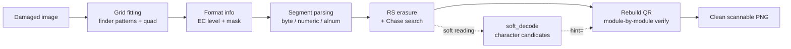

<p align="center">
  <picture>
    <source media="(prefers-color-scheme: dark)" srcset="assets/logo-dark.png">
    
  </picture>
</p>

<p align="center">
  <strong>Decode. Repair. Generate. Route safely. Read any text.</strong><br/>
  A local MCP server that gives any MCP client real QR + OCR capabilities —<br/>
  including the damaged codes that ordinary scanners give up on.
</p>

<p align="center">
  <a href="README.zh-CN.md">简体中文</a> ·
  <a href="#quick-start">Quick start</a> ·
  <a href="#usage-in-mcp-clients">Client setup</a> ·
  <a href="#tools">Tools</a> ·
  <a href="#damaged-code-repair">Repair</a> ·
  <a href="https://modelcontextprotocol.io/">MCP spec</a>
</p>

<p align="center">
  <a href="pyproject.toml"></a>
  <a href="pyproject.toml"></a>
  <a href="LICENSE"></a>
  <a href="#protocol-support"></a>
  <a href="#quick-start"></a>
</p>

<p align="center">
  <a href="tests/selftest.py"></a>
  <a href="#tools"></a>
  <a href="#transports"></a>
  <a href="#safety-by-default"></a>
  <a href="CONTRIBUTING.md"></a>
</p>

<p align="center">
  
  
  
  
  
  
  
</p>

> [!NOTE]
> Run it from source (`pip install -e .`) or, once available on PyPI,
> `pip install qrcode-mcp` / `uvx qrcode-mcp`. Either way the client setup is
> the same — see [Usage in MCP clients](#usage-in-mcp-clients).

---

## Why this exists

Every QR decoder assumes a reasonably clean symbol. Real-world captures — a
phone pointed at a glossy screen, a payment terminal under ceiling lights —
come back with a diagonal glare band that erases a dozen modules. zxing, OpenCV
and ZBar all return a checksum error. That is where this server starts working.

<table>
  <tr>
    <th align="center">What the scanner saw</th>
    <th align="center">What <code>qr_repair</code> recovered</th>
  </tr>
  <tr>
    <td align="center"></td>
    <td align="center"></td>
  </tr>
  <tr>
    <td align="center"><sub>zxing / OpenCV / ZBar → <b>checksum error</b></sub></td>
    <td align="center"><sub>module grid fitted, payload rebuilt, <b>scannable PNG</b></sub></td>
  </tr>
</table>

<sub>The demo pair is synthetic and contains no real device identifiers.
Regenerate it with <code>python assets/build_assets.py</code>.</sub>

On the real glare-damaged sample this project was built from: grid fitting
landed on **Version 3 / pitch 2.948 px / 99.2% function-pattern agreement**,
format information resolved to **EC-L / mask 6**, and hint verification reached
**93.6% module agreement** with the reconstructed symbol.

## Features

| | |
| --- | --- |
| 🔍 **Layered decoding** | zxing-cpp → OpenCV → ZBar → preprocessing variants → automatic repair fallback. Multi-code images, corner points, confidence and payload parsing. |
| 🩺 **Damaged-code repair** | Module-grid fitting, format-information decoding, multi-segment parsing, Reed–Solomon erasure / Chase correction, then module-by-module self-verification. |
| 🎨 **Generation** | `segno`-based, EC / version / mask / scale / border / colors, PNG · SVG · ASCII · base64, optional file output. |
| 🧠 **Pluggable OCR** | Windows built-in WinRT OCR, RapidOCR (offline ONNX) and Tesseract, with `auto` fallback and word-level boxes. |
| 🔐 **Safe by default** | URL opening requires explicit confirmation, blocks dangerous schemes and private hosts, remote image fetching disabled, output confined to one directory. |
| 🔌 **Three transports** | `stdio`, Streamable HTTP and legacy SSE over a pure-standard-library JSON-RPC 2.0 core — no MCP SDK, no port unless you ask for one. |

## Quick start

**From source** (works today):

```bash
git clone https://github.com/xiaobinger/qrcode-mcp
cd qrcode-mcp
python -m venv .venv && . .venv/bin/activate     # Windows: .venv\Scripts\activate
pip install -e .              # core dependencies
pip install -e '.[full]'      # optional: OpenCV, ZBar, all OCR backends
qrmcp --version
```

**From the package** (once `qrcode-mcp` is installed from PyPI):

```bash
pip install qrcode-mcp                 # or: pip install 'qrcode-mcp[full]'
uvx qrcode-mcp qrmcp --version        # no install, on-demand
qrmcp --transport stdio
```

| Extra | What it adds |
| --- | --- |
| *(core)* | `numpy`, `Pillow`, `zxing-cpp`, `segno`, `reedsolo` — decode / repair / generate / parse / open / health |
| `vision` | `opencv-python`, `pyzbar` — extra decode & detection engines |
| `ocr-windows` | Windows 10+ built-in OCR, `zh-Hans-CN` recognizer, word boxes, no model download |
| `ocr-rapid` | `rapidocr_onnxruntime` — offline Chinese + English ONNX models |
| `ocr-tesseract` | `pytesseract` — needs the `tesseract` binary and traineddata |
| `ocr` / `full` | all OCR backends / everything above |
| `dev` | `pytest`, `build`, `twine` |

## Usage in MCP clients

`mcp.entry.json` in this repository is a ready-to-paste stdio fragment. Drop it
into the `mcpServers` object of your client and restart it.

| Client | Where to put the config | Notes |
| --- | --- | --- |
| **WorkBuddy** | `~/.workbuddy/mcp.json` → `mcpServers` | Trust the new server once in the connector panel |
| **Claude Desktop** | `claude_desktop_config.json` (`%APPDATA%\Claude\` on Windows, `~/Library/Application Support/Claude/` on macOS) | Fully restart the app |
| **Cursor** | `.cursor/mcp.json` (project) or `~/.cursor/mcp.json` (global) | Project scope is per-repository |
| **VS Code / Copilot** | `.vscode/mcp.json` | Uses the `servers` key; wrap the snippet accordingly |
| **Cline / Roo Code** | Extension settings → MCP Servers | Paste the JSON body |
| **Cherry Studio / Continue** | Settings → MCP / Tools → import JSON | Pick `stdio` as the transport |
| **Any MCP client** | stdio JSON below | Works with protocol `2024-11-05` … `2025-06-18` |

**From a local checkout** — point `command` at the venv interpreter (or set
`PYTHONPATH` to `src`):

```json
{
  "mcpServers": {
    "qrcode_mcp": {
      "command": "python",
      "args": ["-m", "qrmcp", "--transport", "stdio"],
      "env": { "PYTHONIOENCODING": "utf-8", "PYTHONPATH": "C:/path/to/qrcode-mcp/src" }
    }
  }
}
```

**From an installed package** — use the console script:

```json
{
  "mcpServers": {
    "qrcode_mcp": {
      "command": "qrmcp",
      "args": ["--transport", "stdio"],
      "env": { "PYTHONIOENCODING": "utf-8" }
    }
  }
}
```

**On-demand, no install** (uv):

```json
{
  "mcpServers": {
    "qrcode_mcp": {
      "command": "uvx",
      "args": ["--from", "qrcode-mcp", "qrmcp", "--transport", "stdio"]
    }
  }
}
```

**Shared / HTTP clients** — start one server, point several clients at it:

```bash
qrmcp --transport http --port 8765 --token "$QRMCP_HTTP_TOKEN"
```

```json
{
  "mcpServers": {
    "qrcode_mcp": { "type": "http", "url": "http://127.0.0.1:8765/mcp" }
  }
}
```

Then talk to your client in natural language:

> *"Decode the QR code in this screenshot — if it fails, try repairing it."*
> *"Generate a QR for this URL and save it under out/."*
> *"Read all text in this image and give me the line boxes."*
> *"Parse that QR link first and ask me before opening it."*

## Tools

| Tool | What it does |
| --- | --- |
| `qr_decode` | Layered decode across engines and preprocessing variants; multi-code, corner points, confidence, payload parsing; falls back to `qr_repair` |
| `qr_repair` | Recover glare / blur / low-resolution symbols (QR versions 1–4); returns diagnostics, verification score and a rebuilt scannable PNG |
| `qr_generate` | Generate QR codes with EC / version / mask / scale / border / colors; PNG · SVG · ASCII · base64 |
| `qr_detect` | Locate symbols without decoding — bounding boxes for cropping before repair |
| `qr_parse` | Interpret URL / WiFi / vCard / phone / email / payment payloads, split query parameters, flag phishing-style patterns |
| `qr_open` | Validate and optionally open a QR URL in the system browser |
| `ocr_image` | Full text, line / word boxes and confidence via the pluggable OCR backends |
| `qr_batch` | Batch scan a directory or file list, optionally combining QR + OCR |
| `server_health` | Version, protocol versions, registered tools, backend availability, active safety policy |

All image inputs accept a local path, `file://`, a `data:` URI, a bare base64
string, or an `http(s)` URL when explicitly enabled.

## Damaged-code repair



When glare destroys more codewords than the EC budget can restore, the server
does **not** invent a result. It returns a `soft_decode` with per-character
candidates; pass your best guess as `hint=` to verify it and obtain a scannable
rebuild:

```json
{
  "name": "qr_repair",
  "arguments": {
    "image": "screenshot.png",
    "hint": "https://example.com/qrmcp?sn=12345678901234567890&eC=99",
    "save_clean": true
  }
}
```

<details>
<summary><b>Scope and known limits</b></summary>

- Single-block QR versions 1–4 (21×21 … 33×33). Larger or rotated / mirrored
  symbols are reported as unsupported or best-effort rather than guessed.
- A verification agreement of ≥ 92% on reliable modules is required before a
  reconstruction is accepted as valid.
- Long URLs are encoded as `byte + numeric + byte` segments: `segno` alone would
  put them in one byte segment and overflow Version 3-L, so the verification
  path uses a small in-house multi-segment encoder.
- Windows OCR needs a language pack; WinRT `StorageFile` path APIs are avoided
  in favour of in-memory streams for Python 3.13 compatibility.

</details>

## Transports

| Transport | Command | Endpoint | Use case |
| --- | --- | --- | --- |
| `stdio` *(default)* | `qrmcp --transport stdio` | — | MCP clients launching a subprocess; no port, logs to stderr only |
| `http` | `qrmcp --transport http --port 8765` | `POST/GET/DELETE /mcp` + `Mcp-Session-Id` | Streamable HTTP, spec `2025-03-26`+ |
| `sse` | `qrmcp --transport sse --port 8765` | `GET /sse` + `POST /messages` | Legacy clients on `2024-11-05` |

HTTP/SSE bind to `127.0.0.1` by default; set `--token` or `QRMCP_HTTP_TOKEN`
to require a bearer token. All three share one tool registry.

## Protocol support

`2025-06-18` · `2025-03-26` · `2024-11-05`. The server echoes the client's
version when supported, otherwise falls back to the newest it implements.
Implements `initialize`, `tools/list`, `tools/call`, `ping`, batch requests and
graceful shutdown.

## Safety by default

- `qr_open` **never** opens a URL without `confirm=true`; without it, it only
  validates and returns the normalized URL plus risk flags.
- Blocks `file:`, `javascript:`, `data:`, userinfo, non-standard schemes and
  hosts resolving to private / loopback addresses (SSRF protection).
- `QRMCP_URL_ALLOWLIST` restricts allowed hosts (`*.example.com` supported).
- Remote image fetching is off unless `QRMCP_ALLOW_REMOTE=1`.
- Generated files stay inside `QRMCP_OUTPUT_DIR` (default `./out`); absolute
  paths and `..` traversal are rejected.
- `QRMCP_MAX_IMAGE_BYTES`, `QRMCP_MAX_IMAGE_PIXELS` and
  `QRMCP_DECODE_BUDGET_MS` bound resource usage.

<details>
<summary><b>Full environment variable reference</b></summary>

| Variable | Purpose |
| --- | --- |
| `QRMCP_OUTPUT_DIR` | Directory for generated images |
| `QRMCP_URL_ALLOWLIST` | Comma-separated allowed hosts for `qr_open` |
| `QRMCP_ALLOW_PRIVATE` | Allow private / loopback hosts |
| `QRMCP_ALLOW_REMOTE` | Allow fetching images over `http(s)` |
| `QRMCP_HTTP_TOKEN` | Bearer token for HTTP / SSE |
| `QRMCP_OCR_PRIORITY` | Backend order, e.g. `rapid,windows` |
| `QRMCP_TESSERACT_CMD` | Path to the Tesseract binary |
| `QRMCP_MAX_IMAGE_BYTES` / `QRMCP_MAX_IMAGE_PIXELS` | Input size caps |
| `QRMCP_DECODE_BUDGET_MS` | Decode time budget |
| `QRMCP_LOG_LEVEL` | Logging verbosity |

</details>

## Test status

| Suite | Result | Run it |
| --- | --- | --- |
| End-to-end self-test | **38 / 38 passing** | `PYTHONPATH=src python tests/selftest.py` |
| Portable CI smoke | **16 checks passing** | `python tests/ci_smoke.py` |
| Wheel build | 24 modules, `qrmcp` console script | `python -m pip wheel . --no-deps -w dist` |

The self-test covers all three protocol versions, batch requests, all nine
tools, the three transports end-to-end, token auth, SSE delivery, OCR backends
and the damaged-image repair path. CI runs on Linux + Windows across Python
3.10–3.13 with core dependencies only — see
[`.github/workflows/ci.yml`](.github/workflows/ci.yml).

## Contributing

Issues and PRs are welcome — see [CONTRIBUTING.md](CONTRIBUTING.md). The
shortest useful contribution is a damaged QR sample that currently fails:
include the image and the expected payload.

## License

[MIT](LICENSE) © qrmcp contributors
