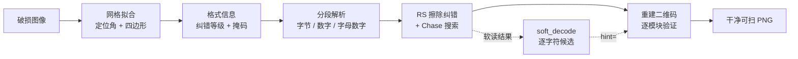

<p align="center">
  <picture>
    <source media="(prefers-color-scheme: dark)" srcset="assets/logo-dark.png">
    
  </picture>
</p>

<p align="center">
  <strong>识别 · 修复 · 生成 · 安全跳转 · OCR</strong><br/>
  一个本地运行的 MCP 服务，为任意 MCP 客户端补齐二维码与文字识别能力，<br/>
  包括那些普通扫码器直接放弃的「反光破损码」。
</p>

<p align="center">
  <a href="README.md">English</a> ·
  <a href="#快速开始">快速开始</a> ·
  <a href="#在各客户端中使用">客户端接入</a> ·
  <a href="#工具清单">工具清单</a> ·
  <a href="#破损修复流程">破损修复</a>
</p>

<p align="center">
  
  
  
  
  
  
</p>

> [!NOTE]
> 两种运行方式：从源码安装（<code>pip install -e .</code>），或使用已安装的包
> （<code>pip install qrcode-mcp</code> / <code>uvx qrcode-mcp</code>）。
> 两者的客户端配置完全一致，见[在各客户端中使用](#在各客户端中使用)。
> 完整英文文档见 [README.md](README.md)。

---

## 为什么做这个

所有二维码解码器都默认「码是干净的」。但真实场景——手机拍带玻璃反光的屏幕、
灯光下的支付终端——常会带一道斜向眩光，把十几个模块直接洗白。zxing、OpenCV、
ZBar 全部返回校验失败。这个项目就是从这个痛点开始的。

<table>
  <tr>
    <th align="center">扫码器看到的</th>
    <th align="center"><code>qr_repair</code> 还原出的</th>
  </tr>
  <tr>
    <td align="center"></td>
    <td align="center"></td>
  </tr>
  <tr>
    <td align="center"><sub>zxing / OpenCV / ZBar → <b>校验失败</b></sub></td>
    <td align="center"><sub>拟合模块网格、重建载荷、<b>输出可扫 PNG</b></sub></td>
  </tr>
</table>

<sub>演示图为合成图，不含任何真实设备标识。可用
<code>python assets/build_assets.py</code> 重新生成。</sub>

在这套算法所来自的真实反光截图上：网格拟合得到 **Version 3 / 模块间距
2.948 px / 功能图形一致率 99.2%**，格式信息判定为 **EC-L / mask 6**，
提示文本验证的模块一致率为 **93.6%**。

## 特性

| | |
| --- | --- |
| 🔍 **分层解码** | zxing-cpp → OpenCV → ZBar → 多预处理变体 → 自动进入修复链路；支持一图多码、角点、置信度与载荷解析 |
| 🩺 **破损修复** | 模块网格拟合、格式信息解码、多段解析、Reed–Solomon 擦除 / Chase 纠错，最后逐模块重建比对自验证 |
| 🎨 **二维码生成** | 基于 `segno`，支持纠错等级 / 版本 / 掩码 / 尺寸 / 边距 / 配色，输出 PNG · SVG · ASCII · base64 |
| 🧠 **可插拔 OCR** | Windows 内置 WinRT OCR、RapidOCR（离线 ONNX）、Tesseract，`auto` 自动降级，返回词级文本框 |
| 🔐 **默认安全** | 跳转必须显式确认，拦截危险协议与内网地址，远程抓图默认关闭，生成文件限定在单一输出目录 |
| 🔌 **三种传输** | `stdio`、Streamable HTTP、legacy SSE，协议层纯标准库 JSON-RPC 2.0，不引入 MCP SDK |

## 快速开始

**从源码运行**：

```bash
git clone https://github.com/xiaobinger/qrcode-mcp
cd qrcode-mcp
python -m venv .venv && .venv\Scripts\activate   # Linux/macOS: . .venv/bin/activate
pip install -e .          # 核心依赖
pip install -e '.[full]'  # 可选：OpenCV / ZBar / 全部 OCR 后端
qrmcp --version
```

**从已安装的包运行**：

```bash
pip install qrcode-mcp               # 或 pip install 'qrcode-mcp[full]'
uvx qrcode-mcp qrmcp --version      # 免安装、按需运行
qrmcp --transport stdio
```

| 附加依赖 | 增加的能力 |
| --- | --- |
| *(核心)* | `numpy` / `Pillow` / `zxing-cpp` / `segno` / `reedsolo` — 解码、修复、生成、解析、跳转、健康检查 |
| `vision` | `opencv-python` / `pyzbar` — 额外解码与定位引擎 |
| `ocr-windows` | Windows 10+ 系统内置 OCR，`zh-Hans-CN` 识别器，词级坐标，无需下载模型 |
| `ocr-rapid` | `rapidocr_onnxruntime` — 离线中英文 ONNX 模型 |
| `ocr-tesseract` | `pytesseract` — 需另装 `tesseract` 与语言包 |
| `ocr` / `full` | 全部 OCR 后端 / 以上全部 |
| `dev` | `pytest` / `build` / `twine` |

## 在各客户端中使用

仓库里的 `mcp.entry.json` 是可直接粘贴的 stdio 配置片段，把它放进客户端配置
的 `mcpServers` 对象后重启客户端即可。

| 客户端 | 配置文件位置 | 说明 |
| --- | --- | --- |
| **WorkBuddy** | `~/.workbuddy/mcp.json` → `mcpServers` | 首次需在连接器面板对新服务点一次 Trust |
| **Claude Desktop** | `claude_desktop_config.json`（Windows `%APPDATA%\Claude\`，macOS `~/Library/Application Support/Claude/`） | 需要完全退出后重启 |
| **Cursor** | `.cursor/mcp.json`（项目级）或 `~/.cursor/mcp.json`（全局） | 项目级按仓库隔离 |
| **VS Code / Copilot** | `.vscode/mcp.json` | 使用 `servers` 键，按该格式包一层 |
| **Cline / Roo Code** | 扩展设置 → MCP Servers | 直接粘贴 JSON |
| **Cherry Studio / Continue** | 设置 → MCP / 工具 → 导入 JSON | 传输类型选 `stdio` |
| **任意 MCP 客户端** | 下方 stdio JSON | 兼容协议 `2024-11-05` … `2025-06-18` |

**本地源码方式** —— `command` 指向虚拟环境里的解释器，或用 `PYTHONPATH`
指向 `src`：

```json
{
  "mcpServers": {
    "qrcode_mcp": {
      "command": "python",
      "args": ["-m", "qrmcp", "--transport", "stdio"],
      "env": { "PYTHONIOENCODING": "utf-8", "PYTHONPATH": "C:/path/to/qrcode-mcp/src" }
    }
  }
}
```

**已安装包方式** —— 直接用控制台命令：

```json
{
  "mcpServers": {
    "qrcode_mcp": {
      "command": "qrmcp",
      "args": ["--transport", "stdio"],
      "env": { "PYTHONIOENCODING": "utf-8" }
    }
  }
}
```

**免安装按需运行**（uv）：

```json
{
  "mcpServers": {
    "qrcode_mcp": {
      "command": "uvx",
      "args": ["--from", "qrcode-mcp", "qrmcp", "--transport", "stdio"]
    }
  }
}
```

**多客户端共享 / HTTP 模式** —— 只起一个服务，多个客户端连它：

```bash
qrmcp --transport http --port 8765 --token "$QRMCP_HTTP_TOKEN"
```

```json
{
  "mcpServers": {
    "qrcode_mcp": { "type": "http", "url": "http://127.0.0.1:8765/mcp" }
  }
}
```

配置好之后直接用自然语言指挥客户端：

> 「识别这张截图里的二维码，扫不出来就尝试修复」
> 「把这个链接生成二维码，存到 out/ 目录下」
> 「读出这张图的全部文字，并给出每行文本框」
> 「先解析这个二维码链接，问我之后再决定要不要打开」

## 工具清单

| 工具 | 作用 |
| --- | --- |
| `qr_decode` | 多引擎分层解码，支持一图多码、角点、置信度、载荷解析，失败自动转 `qr_repair` |
| `qr_repair` | 修复反光 / 模糊 / 低分辨率二维码（Version 1–4），返回诊断、验证一致率与可扫重建图 |
| `qr_generate` | 生成二维码，支持 EC / 版本 / 掩码 / 尺寸 / 配色，PNG · SVG · ASCII · base64 |
| `qr_detect` | 只定位不解码，返回包围框，便于裁剪后再修复 |
| `qr_parse` | 解析 URL / WiFi / vCard / 电话 / 邮件 / 支付码，拆分 query，标记可疑引流特征 |
| `qr_open` | 校验并（在确认后）用系统浏览器打开二维码链接 |
| `ocr_image` | 全文 + 逐行 / 逐词文本框 + 置信度，后端可插拔 |
| `qr_batch` | 目录或文件列表批量扫描，可联合二维码与 OCR |
| `server_health` | 版本、协议版本、工具清单、各后端可用性、当前安全策略 |

图片输入统一支持本地路径、`file://`、`data:` URI、裸 base64，
以及显式开启后的 `http(s)` URL。

## 破损修复流程



当眩光吞掉的码字超过纠错预算时，服务**不会编造结果**：它返回
`soft_decode` 逐字符候选，你把最可能的内容作为 `hint=` 传回去，
即可完成验证并得到可扫的重建图：

```json
{
  "name": "qr_repair",
  "arguments": {
    "image": "screenshot.png",
    "hint": "https://example.com/qrmcp?sn=12345678901234567890&eC=99",
    "save_clean": true
  }
}
```

<details>
<summary><b>适用范围与已知限制</b></summary>

- 仅支持单块二维码 Version 1–4（21×21 … 33×33）；更高版本、旋转 / 镜像码会明确报
  不支持或 best-effort，不做猜测。
- 重建结果需在高置信度模块上达到 ≥ 92% 一致率才判定为有效。
- 长 URL 采用「字节段 + 数字段 + 字节段」多段编码：`segno` 会把它塞进单个字节段
  导致 Version 3-L 溢出，因此验证链路使用包内自研的多段编码器。
- Windows OCR 需要系统语言包；为兼容 Python 3.13，避开了 WinRT `StorageFile`
  路径 API，改走内存流。

</details>

## 传输与协议

| 传输 | 启动命令 | 端点 | 适用 |
| --- | --- | --- | --- |
| `stdio`（默认） | `qrmcp --transport stdio` | — | 客户端拉起子进程，不监听端口，日志只走 stderr |
| `http` | `qrmcp --transport http --port 8765` | `POST/GET/DELETE /mcp` + `Mcp-Session-Id` | Streamable HTTP |
| `sse` | `qrmcp --transport sse --port 8765` | `GET /sse` + `POST /messages` | 旧版 `2024-11-05` 客户端 |

支持协议版本 `2025-06-18` / `2025-03-26` / `2024-11-05`，实现
`initialize`、`tools/list`、`tools/call`、`ping`、批量请求与优雅关闭。

## 默认安全策略

- `qr_open` 未传 `confirm=true` 时**绝不打开**，只做校验并返回规范化 URL 与风险标记。
- 拦截 `file:` / `javascript:` / `data:`、userinfo、非标准协议，
  以及解析到内网 / 回环地址的主机（SSRF 防护）。
- `QRMCP_URL_ALLOWLIST` 可限定允许域名（支持 `*.example.com`）。
- 远程抓图默认关闭，需 `QRMCP_ALLOW_REMOTE=1`。
- 生成文件限定在 `QRMCP_OUTPUT_DIR`（默认 `./out`），拒绝绝对路径与 `..` 穿越。
- `QRMCP_MAX_IMAGE_BYTES` / `QRMCP_MAX_IMAGE_PIXELS` / `QRMCP_DECODE_BUDGET_MS`
  限制资源消耗。

<details>
<summary><b>完整环境变量</b></summary>

| 变量 | 作用 |
| --- | --- |
| `QRMCP_OUTPUT_DIR` | 生成图片的输出目录 |
| `QRMCP_URL_ALLOWLIST` | `qr_open` 允许的域名白名单 |
| `QRMCP_ALLOW_PRIVATE` | 是否允许内网 / 回环地址 |
| `QRMCP_ALLOW_REMOTE` | 是否允许 `http(s)` 抓取图片 |
| `QRMCP_HTTP_TOKEN` | HTTP / SSE 的 Bearer Token |
| `QRMCP_OCR_PRIORITY` | 后端顺序，如 `rapid,windows` |
| `QRMCP_TESSERACT_CMD` | Tesseract 可执行文件路径 |
| `QRMCP_MAX_IMAGE_BYTES` / `QRMCP_MAX_IMAGE_PIXELS` | 输入体积上限 |
| `QRMCP_DECODE_BUDGET_MS` | 解码耗时预算 |
| `QRMCP_LOG_LEVEL` | 日志级别 |

</details>

## 测试状态

| 套件 | 结果 | 运行方式 |
| --- | --- | --- |
| 端到端自检 | **38 / 38 通过** | `PYTHONPATH=src python tests/selftest.py` |
| 跨平台 CI 冒烟 | **16 项通过** | `python tests/ci_smoke.py` |
| wheel 构建 | 24 个模块 + `qrmcp` 命令 | `python -m pip wheel . --no-deps -w dist` |

CI 在 Linux / Windows × Python 3.10–3.13 上只装核心依赖运行，配置见
[`.github/workflows/ci.yml`](.github/workflows/ci.yml)。

## 贡献与许可

欢迎 Issue 与 PR，见 [CONTRIBUTING.md](CONTRIBUTING.md)。
最有价值的贡献是一张当前修复失败的破损二维码样本：附上原图与期望载荷即可。

[MIT](LICENSE) © qrmcp contributors
